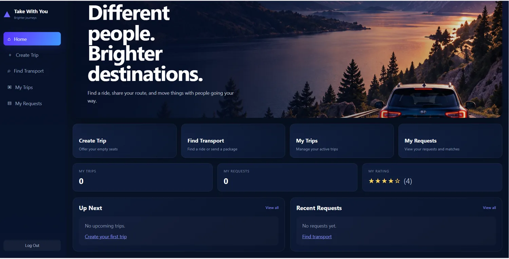
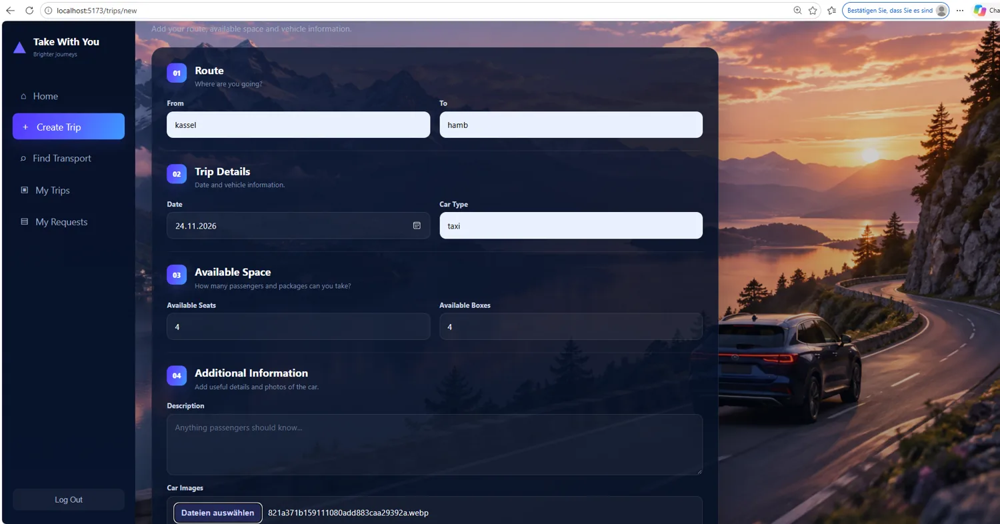
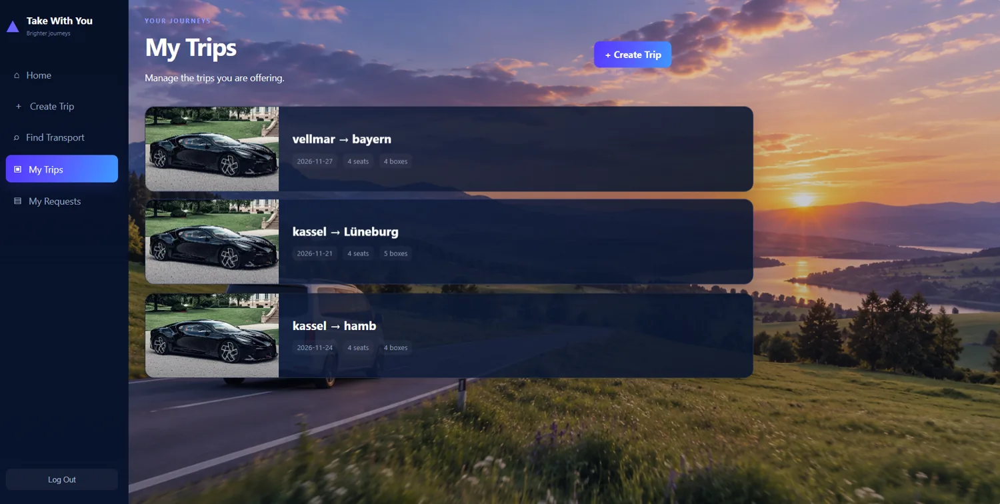
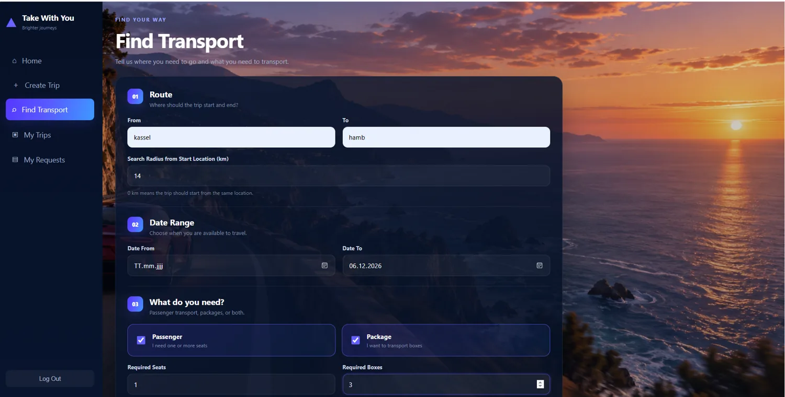
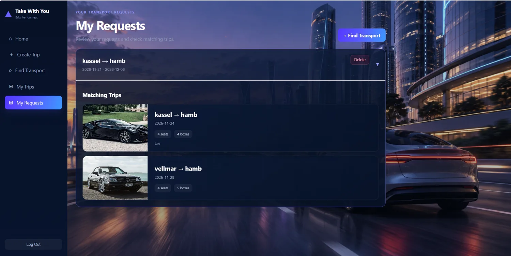
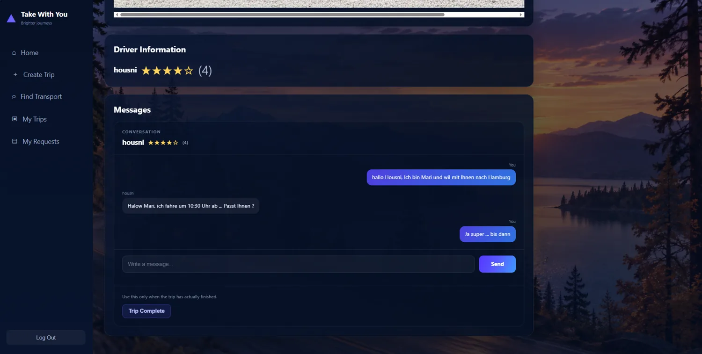

# Take With You

**A full-stack platform for connecting people who travel with people who need items delivered.**

Built as a portfolio project with a **React** frontend, a **Node.js / Express** API, **CouchDB** persistence, and **WebSocket** messaging.

> **Project status:** This repository documents a development-stage application. Its route structure and core implementation have been reviewed, but the application has not been end-to-end tested or independently deployed as part of this documentation work.

## Overview

Take With You brings together two types of activity:

- **Trips:** A user can publish an upcoming trip.
- **Needs:** Another user can publish a request for an item or assistance.

The backend provides routes and services for finding potential matches, communicating, and recording trip completion and ratings. The application is an example of a multi-layer full-stack system rather than a static UI demo.

## Main capabilities

| Area | Implemented code / modules |
| --- | --- |
| Accounts | Registration and login with hashed passwords (`bcryptjs`) |
| Trip management | Trip routes, database access, and React pages |
| Needs and requests | Need routes, repositories, and create/list pages |
| Matching | Matching routes, matching service, and distance/geocoding services |
| Communication | Message routes, conversation service, and WebSocket chat server |
| Follow-up | Trip completion and rating routes |
| Maintenance | CouchDB indexes and scheduled cleanup of expired data |

The presence of a route does not imply that every user flow has been independently verified.

## Screenshots

The following screenshots showcase the core user journey, from managing trips and transport requests to matching and real-time communication.

### 1. Dashboard

A central overview with navigation, quick actions, upcoming trips, recent requests, and user ratings.



### 2. Create a trip

Drivers can enter departure and destination, journey date, vehicle information, available seats and package capacity, and optionally add car images.



### 3. My trips

A personal overview of published journeys, including route, date, available seats, packages, and vehicle photos.



### 4. Create a transport request

Users can specify their route, an optional departure radius, travel date range, and whether they need passenger seats, package transportation, or both.



### 5. Matching trips

Requests display matching journeys with driver/vehicle details and available transport capacity.



### 6. Messaging and trip completion

A conversation interface enables communication between participants; trip details include driver ratings and completion controls.



## Technology stack

| Component | Technology |
| --- | --- |
| Frontend | React 19, React Router 7, Vite 8, CSS |
| Backend | Node.js (ES modules), Express 5 |
| Database | Apache CouchDB, `nano` client |
| Real-time chat | WebSockets (`ws`) |
| Authentication utilities | `bcryptjs` |
| File upload handling | `formidable` |
| Cross-origin requests | `cors` |

## Architecture

```text
                 React frontend (Vite)
                          |
                  HTTP requests / WebSocket
                          |
                 Node.js + Express API
                   /             \
             Route handlers    WebSocket chat
                   |
               Services
                   |
              Repositories
                   |
                 CouchDB
```

### Repository structure

```text
take-with-you/
├── backend/
│   ├── config/          # Database and query configuration
│   ├── database/        # CouchDB access and index creation
│   ├── repositories/    # Persistence operations
│   ├── routes/          # Express API endpoints
│   ├── services/        # Matching, geocoding, cleanup, conversations
│   ├── websocket/       # WebSocket chat server
│   ├── uploads/         # Upload-related content
│   └── server.js        # API / HTTP server entry point
├── frontend/
│   ├── src/
│   │   ├── auth/
│   │   ├── components/
│   │   ├── layouts/
│   │   ├── pages/
│   │   └── services/
│   └── package.json
├── .env.example         # Non-secret local configuration template
├── .gitignore
├── package.json         # Backend dependencies
└── README.md
```

## Run locally

### Prerequisites

- A recent Node.js version compatible with the React/Vite toolchain (Node.js 24 is one option).
- npm.
- Apache CouchDB running locally, with an administrative user able to create the application database.
- A modern browser.

### 1. Clone and install dependencies

```bash
git clone https://github.com/housnizalam/take-with-you.git
cd take-with-you
npm install
cd frontend
npm install
cd ..
```

### 2. Configure CouchDB without committing credentials

Create your local environment file from the example:

```bash
cp .env.example .env
```

On Windows PowerShell:

```powershell
Copy-Item .env.example .env
```

Edit `.env` to use **your own newly created CouchDB credentials**. Never paste credentials into source files or commit `.env` to Git.

| Variable | Purpose |
| --- | --- |
| `COUCHDB_PROTOCOL` | Usually `http` for local development |
| `COUCHDB_HOST` | CouchDB hostname (default `127.0.0.1`) |
| `COUCHDB_PORT` | CouchDB port (default `5984`) |
| `COUCHDB_USERNAME` | Required database username |
| `COUCHDB_PASSWORD` | Required database password |
| `COUCHDB_DATABASE` | Application database (default `take_with_you`) |

`backend/config/databaseConfig.js` now reads credentials from **environment variables** and fails clearly if required values are missing.

### 3. Start the backend

With **Node.js 20.6+**, use the built-in environment-file flag from the repository root:

```bash
node --env-file=.env backend/server.js
```

The backend currently listens on **http://localhost:3000**, with a test endpoint at **http://localhost:3000/api**. At startup it connects to CouchDB, creates indexes, runs cleanup, and initializes chat.

### 4. Start the frontend

Open a second terminal:

```bash
cd frontend
npm run dev
```

Open the URL printed by Vite (typically **http://localhost:5173**). The backend currently allows that local frontend origin in its CORS configuration.

**Note:** Commands above are based on current source and package scripts. They have not been fully smoke-tested in a clean environment. File-upload paths, frontend configuration, and platform-specific behavior may require further setup.

## Selected API areas

The backend mounts:

- `/api/auth` — registration and login
- `/api/users` — user operations
- `/api/trips` — trips
- `/api/needs` — requests
- `/api/matches` — matching
- `/api/messages` — messages
- `/api/trip-completions` — trip completion
- `/api/ratings` — ratings

See `backend/routes/` for the actual methods, payload formats, and validation.

## Security and deployment status

**Do not deploy this repository as-is without a security review.**

- **Database credentials:** The current `databaseConfig.js` reads values from the environment; the local `.env` file is Git-ignored. **However, an earlier commit contained a CouchDB password. Changing the current file does not remove it from Git history.** Rotate/revoke the old database password, and clean the repository history before making the repository public. Anyone who has already accessed that history may have copied it.
- **Tracked dependencies:** `node_modules/` was previously committed. The new `.gitignore` prevents adding untracked dependencies going forward, but does **not** untrack files already committed. Remove tracked dependencies in a separate cleanup commit.
- Review authentication, authorization, user-provided content, file uploads, WebSocket access, CORS, and rate limiting before production deployment.
- Use TLS, separate production credentials, least-privilege database accounts, backups, and centralized configuration in production.

## Portfolio highlights

This project illustrates:

- Building a component-based React interface.
- Separating Express routes, services, repositories, and database access.
- Working with a document database (CouchDB).
- Adding WebSocket-based real-time communication.
- Integrating a frontend with an API and persistence.
- Improving configuration hygiene by separating local secrets from source code.

## Next improvements

- Add genuine screenshots or a short demo video (without exposing user data).
- Test installation from a clean clone and provide an automated smoke test.
- Add API documentation and integration tests.
- Clean tracked build/dependency artifacts.
- Complete the security checklist and production configuration.

---

**Author:** [Housni Zalam](https://github.com/housnizalam)  
**Purpose:** Software engineering / full-stack development portfolio project.
